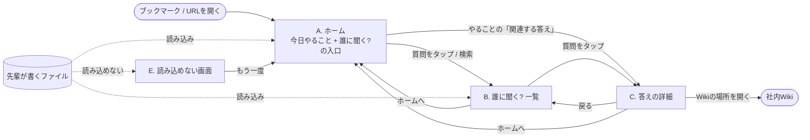

# 03 画面フロー: 最初の週ガイド

`02_企画書.md` の「必須」3つだけを画面にする。「次に」(画面での編集・通知)と「やらない」(ログイン・サーバー保存・実名)は入れない。

## 全体の流れ

画面は4つ(A・B・C・E)。B の中の「見つからないとき」は別画面にせず、B の表示の1つとして扱う。

---

## A. ホーム(今日やること)

最初の画面。成功基準の「30秒以内に今日やることと法人カードの担当を見つける」はこの画面で決まる。

| | 内容 |
|---|---|
| **入ってくる道** | ・ブックマークやURLから開く(出社直後、困ったとき) ・B・C の「ホームへ」 ・E の「もう一度」で読み込みに成功したとき |
| **すること** | ・今日が何日目かを見る(開始日から自動で決める。1〜5日目のタブで他の日も見られる) ・今日のやることを上から順に見る ・終わったものに「できた」をつける / 外す(ブラウザにだけ保存) ・「残りだけ表示」に切り替える ・画面上部の「誰に聞く?」で、よくある質問ボタン(パスワード・法人カード・会議室・休暇)を押す、または検索欄に入力する |
| **出ていく道** | ・よくある質問ボタン → **C. 答えの詳細**(その質問) ・検索欄で入力して決定 / 「すべての質問」 → **B. 誰に聞く? 一覧**(入力した言葉で絞り込み済み) ・やることの「関連する答え」リンク → **C. 答えの詳細** |

**画面の決まり**
- スマホでもノートPCでも、最初に見える範囲に「今日やること」の先頭と「誰に聞く?」の入口が両方入る。横スクロールしない。
- 開始日より前は1日目、6日目以降は5日目を表示し、「最初の週は終わりました」と一言出す。
- 「できた」の記録が読めない・消えたときも、やることはそのまま表示する(全部「まだ」になるだけ)。

---

## B. 誰に聞く? 一覧

| | 内容 |
|---|---|
| **入ってくる道** | ・A の検索欄 / 「すべての質問」 ・C の「戻る」 |
| **すること** | ・分類(総務・IT・人事)ごとに質問を見る ・検索欄で絞り込む(質問文とキーワードの両方を探す。例: 「カード」で法人カードが出る) ・各行で質問と担当(役割)だけ先に見る |
| **出ていく道** | ・質問をタップ → **C. 答えの詳細** ・「ホームへ」 → **A. ホーム** |

**見つからないとき(B の中の表示)**
- 検索して0件のとき、「このガイドにはまだありません」と出し、聞き先として **指導役の先輩** を表示する。答えは作らない。

---

## C. 答えの詳細

| | 内容 |
|---|---|
| **入ってくる道** | ・A のよくある質問ボタン / やることの「関連する答え」 ・B で質問をタップ |
| **すること** | ・答えを読む ・担当(役割)を見る — 誰に聞けばいいかが一番目立つように ・Wikiの場所を見る / 開く ・状態が「要確認」の質問では、答えの代わりに「要確認」と聞き先を見る |
| **出ていく道** | ・「戻る」 → 来た画面(**B** または **A**) ・「ホームへ」 → **A. ホーム** ・Wikiの場所 → 社内Wiki(このガイドの外) |

**画面の決まり**
- 人は役割だけ(「経営支援担当」など)。実名・連絡先・社員番号は出さない。
- 答えは `wiki_一覧.md` にあるものだけ。ないものは「要確認」。

---

## E. 読み込めない画面

| | 内容 |
|---|---|
| **入ってくる道** | ・先輩が書くファイルが読めない / 書き方がまちがっているとき、A・B・C の代わりに出る |
| **すること** | ・「ガイドを読み込めませんでした」と、指導役の先輩に伝えることを見る |
| **出ていく道** | ・「もう一度」 → 読み込めたら **A. ホーム** |

---

## 画面にしないもの

| もの | 理由 |
|---|---|
| 先輩の編集画面 | 「次に」の範囲。今は先輩がファイルを直接書く |
| ログイン画面 | 「やらない」。記録はブラウザだけ |
| 「何日目ですか?」を聞く最初の画面 | 30秒の目標に余計な1手が増える。開始日はファイルに書き、自動で決める |

---

## データの表

### 1. 設定(先輩が書くファイル)

| 項目 | 例 |
|---|---|
| 開始日 | 2026-11-16 |
| ガイドの名前 | 最初の週ガイド |
| 見つからないときの聞き先 | 指導役の先輩 |

### 2. やること(先輩が書くファイル)

| id | 日目 | 順番 | やること | 説明 | 関連する質問 |
|---|---|---|---|---|---|
| t01 | 1 | 1 | 出勤を押す | グループウェア > 勤怠 > 出勤 | q08 |
| t02 | 1 | 2 | パスワードを変える | 最初のパスワードから自分のものに変える | q05 |
| t03 | 1 | 3 | メールの署名を作る | チームのひな形は先輩からもらう | q07 |
| t04 | 2 | 1 | 必須研修を申し込む | 入社1か月以内に2コース | q10 |
| t05 | 3 | 1 | 名刺を申請する | 英語表記もあわせて書く | q04 |

### 3. 質問と答え(先輩が書くファイル。元は `自分の業務/wiki_一覧.md`)

| id | 分類 | 質問 | キーワード | 答え | 担当(役割) | Wikiの場所 | 状態 |
|---|---|---|---|---|---|---|---|
| q01 | 総務 | 法人カードを作りたい | カード, クレジット | チーム長の承認を受けたあと、経営支援に申請書を出す。通常3日 | 経営支援担当 | 総務 > 法人カード | あり |
| q03 | 総務 | 会議室を予約したい | 会議, 部屋, 予約 | グループウェア > 設備予約 > 会議室。30分単位 | 経営支援担当 | 総務 > 会議室 | あり |
| q05 | IT | パスワードを変えたい / 忘れた | ログイン, PW | グループウェアのトップ > 個人情報 > パスワード。忘れたらログイン画面の「パスワードを忘れた場合」 | ITサポート担当 | IT > パスワード | あり |
| q09 | 人事 | 休暇を取りたい | 休み, 有給 | 入社した月から使える。グループウェア > 勤怠 > 休暇申請、チーム長の承認 | 人事担当 | 人事 > 休暇 | あり |
| q11 | IT | Wi-Fiにつなぎたい | 無線, ネット | (なし) | 指導役の先輩 | (なし) | 要確認 |

- 「よくある質問ボタン」に出すのは q05・q01・q03・q09(パスワード・法人カード・会議室・休暇)。
- q11 はWikiにないので、答えを書かずに「要確認」とする。

### 4. できた記録(新入社員のブラウザにだけ保存)

| やることid | できた日時 |
|---|---|
| t01 | 2026-11-16 09:05 |
| t02 | 2026-11-16 09:20 |

- サーバーには送らない。名前などその人が分かる情報は入れない。
- 消えても、やることと答えは表示できる(できた印がなくなるだけ)。
